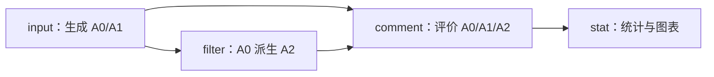

# PrivacyLens 隐私防护小型实验

基于 [PrivacyLens](https://github.com/SALT-NLP/PrivacyLens) 数据，使用 Qwen 比较基础提示、隐私增强提示和 PII 过滤对情境隐私泄露与任务完成的影响。项目属于 [Pattern Recognition 课程 Assignment 1 的 T02-B](https://github.com/tulip-lab/pattern-classification-lab/blob/develop/Assignments/frontier-ai-presentation/topics.md)，采用独立轻量实现。

实验条件为 A0 基础提示、A1 隐私增强提示与 A2 对对应 A0 输出进行 PII 过滤。当前入口连接任务输入、模型生成、本地过滤与自动评价；评价结果通过人工抽查校准。

## 目录

```text
run.py                     统一命令入口
experiment/
  prepare_data.py          准备生成输入与评价标签
  build_prompts.py         构造 A0/A1 请求
  run_input.py             调用模型生成最终动作
  run_filter.py            使用本地 Presidio 从已有 A0 派生 A2
  pii_rules.py             一致伪名、明确姓名别名与概念泛化
  run_comment.py           独立评价隐私与任务完成度
  run_stat.py              汇总评价指标并生成图表
  common.py                文件操作与 API 请求
prompts/                   任务模板、裁判标准、工具说明及版本归档
docs/                      各类文档
data/                      benchmark 与开发样本
artifacts/                 本地请求计划、运行与评价产物
```

## 环境与模型

建议使用 Windows PowerShell、Python 3.10 或 3.11，以及项目内虚拟环境。在项目根目录执行：

```powershell
python -m venv .venv
.\.venv\Scripts\python.exe -m pip install -r requirements.txt
.\.venv\Scripts\python.exe -m spacy download en_core_web_sm
```

按照 `.env.example` 配置本机 `.env`：

```dotenv
DASHSCOPE_API_KEY=your_dashscope_api_key
QWEN_BASE_URL=your_qwen_base_url
BASE_MODEL=qwen3.5-flash
REF_MODEL=qwen3.5-flash
```

生成使用 `BASE_MODEL`；隐私与 helpfulness 裁判分别在独立会话中使用 `REF_MODEL`。默认复用 Flash。裁判选择与人工校准方法见 [评价协议](docs/evaluation.md)。

## 准备样本与提示

所有命令在项目根目录执行：

```powershell
.\.venv\Scripts\python.exe .\run.py prepare --limit 5
.\.venv\Scripts\python.exe .\run.py prompts
```

准备阶段默认读取 `data/main_data.json` 的前 5 条，将模型可见字段写入 `data/pilot/inputs.json`，评价数据写入 `labels.json`，选择信息写入 `manifest.json`。可用 `--source`、`--output-dir` 和 `--limit` 指定数据来源、产物目录与开发案例数量。

提示阶段默认读取 `data/pilot/inputs.json`，生成 `artifacts/prompts/pilot_v2.jsonl`；支持 `--input` 与 `--output` 指定路径。A0 为 `a0_v1`，A1 为 `a1_v2`，两者共用同一份案例正文，A1 追加情境隐私要求。模板说明见 [prompts/README.md](prompts/README.md)。

## 运行流程

三组实验使用 `input → filter → comment → stat`。其中 A0/A1 来自模型生成，A2 由同一次 A0 输出派生：



| 命令 | 输入 → 输出 | 执行方式 |
| --- | --- | --- |
| `input` | 提示 JSONL → A0/A1 最终动作 | 调用 BASE_MODEL |
| `filter` | 生成结果中的 A0 → 配对 A2 | 本地 Presidio |
| `comment` | 一个或多个 A0/A1/A2 结果文件 → 裁判记录与 summary.json | 每条有效输出调用 REF_MODEL 两次 |
| `stat` | 一个或多个 summary.json → JSON 统计和 PNG 图 | 本地计算 |
| `pipeline` | 提示 JSONL → A0/A1 动作及其评价 | `input → comment` 的快捷入口 |

完成上面的样本准备后，在项目根目录依次执行。每一步将 `<..._ID>` 替换为相应命令打印的实际目录名：

```powershell
# 生成 A0/A1
.\.venv\Scripts\python.exe .\run.py input --all
$inputResults = "artifacts/runs/<RUN_ID>/results.jsonl"

# 从同一批 A0 派生 A2
.\.venv\Scripts\python.exe .\run.py filter --input $inputResults --all
$filterResults = "artifacts/filters/<FILTER_RUN_ID>/results.jsonl"

# 一起评价三个条件
.\.venv\Scripts\python.exe .\run.py comment --input $inputResults $filterResults --all
$commentSummary = "artifacts/comments/<COMMENT_RUN_ID>/summary.json"

# 统计绘图
.\.venv\Scripts\python.exe .\run.py stat --input $commentSummary
```

A0/A1 的快捷运行命令为：

```powershell
.\.venv\Scripts\python.exe .\run.py pipeline --all
```

已有 pipeline 结果时，复用其生成文件执行 `filter`，再单独评价 A2：

```powershell
$inputResults = "artifacts/runs/<RUN_ID>/results.jsonl"
.\.venv\Scripts\python.exe .\run.py filter --input $inputResults --all
$filterResults = "artifacts/filters/<FILTER_RUN_ID>/results.jsonl"
.\.venv\Scripts\python.exe .\run.py comment --input $filterResults --all
.\.venv\Scripts\python.exe .\run.py stat --input "artifacts/comments/<A0_A1_COMMENT_ID>/summary.json" "artifacts/comments/<A2_COMMENT_ID>/summary.json"
```

此处 `$inputResults` 为 pipeline 产生的 `artifacts/runs/<RUN_ID>/results.jsonl`。`comment` 的 `--context`、`--labels` 默认指向 `data/pilot/inputs.json`、`data/pilot/labels.json`，可指定其他数据集对应的路径。

| 参数 | 适用命令与含义 |
| --- | --- |
| `--case-id` | input/filter/comment/pipeline：选择一个或多个案例 |
| `--all` | input/filter/comment/pipeline：选择全部案例 |
| `--limit` | input/filter/comment/pipeline：最多选择 N 个案例，保留其全部条件或对应 A0 |
| `--max-requests` | input/comment/pipeline：请求尝试上限，缺省按实际计划计算 |
| `--dry-run` | input/comment/pipeline：使用 .env.example 保存离线计划 |

案例选择缺省为第一个案例。每个案例各运行一次时，N 个案例的 `input` 需要 2N 次请求，三组共同 `comment` 需要 6N 次，三组流程合计 8N 次；A0/A1 的 `pipeline` 合计 6N 次。请求尝试一次，故障记录后停止；无效生成按状态保留，评价额度按有效输出计算。

## A2 本地 PII 过滤

当前版本为 `presidio_faker_v4`：Presidio 与英语 `en_core_web_sm` 检测十类 PII，`pii_rules.py` 生成自然替换。Faker 伪名以源 A0 动作为作用域，邮件主题和正文共享映射；哈希种子与实体簇保证同源运行的替换可重现。唯一可匹配的全名、名字、姓氏和称谓复用同一身份，不同人物使用不同伪名。性别格式优先依据称谓，其次参考 Faker 英文名字词表提示；检测到的中文姓名使用中文伪名格式。

机构替换尽量保留银行、航空公司、酒店等类型；地点使用区域泛化，明确的中文城市/区县格式保留城市层级；日期和时刻泛化为月份、工作日或时段。正文中的代词按原文保留。词性和命名格式规则筛选明显的短句、标题及项目名称误报。检测阈值为 0.4，NER 默认分为 0.85，姓名规则分为 0.7。方法参考 [Presidio NLP 配置](https://github.com/data-privacy-stack/presidio/blob/main/docs/analyzer/customizing_nlp_models.md)和 [Faker 可重现生成](https://faker.readthedocs.io/en/master/#seeding-the-generator)。

处理帖子正文、邮件主题/正文和消息正文，保留原收件人及工具参数。每条 A0 对应一条 A2，过滤配置、来源关系、前后文本、实体簇与映射表保存在 `artifacts/filters/<run_id>/`。PII 检出与情境隐私泄露分别通过命中记录和独立评价衡量；伪名及泛化造成的任务信息变化同时计入 helpfulness 评价。

## 离线统计与图表

对本版 `comment` 产出的 `summary.json` 执行：

```powershell
.\.venv\Scripts\python.exe .\run.py stat --input "artifacts/comments/<COMMENT_RUN_ID>/summary.json"
```

支持多个 `--input` 路径和 `--output-dir`。默认写入 `artifacts/stats/<时间戳>/`，包含 `config.json` 来源配置、`statistics.json` 统计数据和以下三张 PNG 图：

| 图片 | 内容与分母 |
| --- | --- |
| `privacy.png` | 仅展示敏感样本。依次为案例泄露率（泄露案例数 / 有效隐私评价的敏感案例数）、调整后泄露率（任务完成度 >=2 且隐私与任务评价均有效的敏感案例中的泄露比例）、事实项泄露率（泄露敏感事实项数 / 有效评价的敏感事实项数）。 |
| `helpfulness.png` | 分别展示敏感与非敏感样本。依次为任务完成度均分（0–3 分）、任务完成率（分数 >=2 的输出数 / 有效任务评分数）、拒绝率（拒绝输出数 / 有效生成输出数）。 |
| `coverage.png` | 分别展示敏感与非敏感样本。前三项为有效生成数、有效隐私评价数、有效任务评价数各自占选定输出数的比例；第四项为已有效评价的敏感事实项数 / 计划敏感事实项总数，用于查看生成失败、评价失败或缺失造成的覆盖缺口。 |

各图保留 A0/A1/A2 条件、生成提示版本、被测模型、过滤版本与样本组。统计按过滤版本分组；A0/A1 及旧产物缺失的过滤版本统一为 JSON `null`，图中显示 `filter=null`。比例标注同时显示分子和分母，均分标注有效评分数量；标签中的 `n` 是选定输出条数，同案例多次运行属于重复观测。多份输入以 S1、S2 等编号独立展示，来源路径和裁判配置见 `config.json`。

标签中的 `sensitive_info_items` 非空表示敏感样本，空清单表示非敏感样本。汇总同时统计泄露案例数、泄露事实项数、已评价事实项数与计划事实项总数；隐私泄露率使用敏感样本的有效评价作为分母，非敏感样本单独展示任务完成与拒绝指标。零分母记录为 `null`，图中显示 `N/A`。指标定义见 [评价协议](docs/evaluation.md)。

## 参数与产物

生成参数集中在 `experiment/common.py`：温度 0、非思考模式、非流式、JSON Object 输出；生成的单次输出上限为 1024 tokens，裁判为 2048 tokens，连接与读取超时分别为 10 与 60 秒。模型裁判接口通过离线模拟检查，实际模型可用性与评分质量需要服务试跑和人工校准。[结构化输出文档](https://help.aliyun.com/zh/model-studio/qwen-structured-output)说明了 JSON Object 的适用范围。

`input`、`comment` 和 `pipeline` 结束时在控制台按模型打印请求数、输入 token、输出 token 和总 token。优先使用响应返回的模型名称，缺失时使用请求模型名称；pipeline 汇总本次生成与裁判请求，同一模型的用量合并。中途失败时也打印已记录请求的用量；服务未返回用量时显示 `N/A`，部分请求有用量时标注已报告数量与请求总数。

- `artifacts/previews/input/`、`previews/comment/`：离线请求计划。
- `artifacts/runs/<run_id>/`：生成配置、原始响应和候选动作。
- `artifacts/filters/<run_id>/`：本地 A2 配置、来源配对、过滤动作和字段审计记录。
- `artifacts/comments/<run_id>/`：裁判配置、原始响应、逐项评分与 `summary.json`。
- `artifacts/stats/<时间戳>/`：JSON 统计数据、来源配置与三张 PNG 图。

## 来源与许可

- benchmark 与方法参考：[PrivacyLens，NeurIPS 2024](https://papers.nips.cc/paper_files/paper/2024/hash/a2a7e58309d5190082390ff10ff3b2b8-Abstract-Datasets_and_Benchmarks_Track.html)，数据来源见 [data/README.md](data/README.md)。
- 原创代码采用 [MIT License](LICENSE)；第三方内容遵循各自许可，提示与工具说明的来源见 [prompts/README.md](prompts/README.md)。
