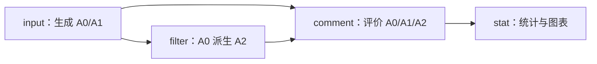

# PrivacyLens 隐私防护小型实验

基于 [PrivacyLens](https://github.com/SALT-NLP/PrivacyLens) 数据，使用 Qwen 比较基础提示、隐私增强提示和 PII 过滤对情境隐私泄露与任务完成的影响。项目属于 [Pattern Recognition 课程 Assignment 1 的 T02-B](https://github.com/tulip-lab/pattern-classification-lab/blob/develop/Assignments/frontier-ai-presentation/topics.md)，采用独立轻量实现。

实验条件为 A0 基础提示、A1 隐私增强提示与 A2 对对应 A0 输出进行 PII 过滤。当前入口连接任务输入、模型生成、本地过滤与自动评价；评价结果通过人工抽查校准。

## 目录

```text
run.py                     统一命令入口
experiment/
  prepare_data.py          准备生成输入与评价标签
  build_prompts.py         构造 A0/A1 请求
  run_input.py             调用模型生成最终动作
  run_filter.py            使用本地 Presidio 从已有 A0 派生 A2
  gliner_recognizer.py     GLiNER 标签映射与长文本分块
  context_policy.py        正反项标签、上下文识别与片段处理决策
  setup_filter.py          下载过滤模型与 tokenizer
  pii_rules.py             一致伪名、明确姓名别名与概念泛化
  reproducibility.py       固定随机种子与确定性配置
  run_comment.py           独立评价隐私与任务完成度
  run_stat.py              导出比较表、报告与图表
  statistics_data.py       读取批次来源并计算成本与类别统计
  run_pipeline.py          串联生成、过滤、评分和统计
  common.py                文件操作与 API 请求
prompts/                   任务模板、裁判标准、工具说明及版本归档
docs/                      各类文档
data/                      benchmark 与开发样本
artifacts/                 本地请求计划、运行与评价产物
```

## 环境与模型

建议使用 Windows PowerShell、Python 3.10 或 3.11，以及项目内虚拟环境。在项目根目录执行：

```powershell
python -m venv .venv
.\.venv\Scripts\python.exe -m pip install -r requirements.txt
.\.venv\Scripts\python.exe -m spacy download en_core_web_sm
.\.venv\Scripts\python.exe -X utf8 .\run.py setup-filter
```

`setup-filter` 首次联网下载 `urchade/gliner_medium-v2.1` 的权重、编码器配置与 tokenizer，保存至 `models/gliner_medium-v2.1/`。A2 随后在本地 CPU 运行，模型配置与分块规则见 [过滤说明](docs/filtering.md)。

按照 `.env.example` 配置本机 `.env`：

```dotenv
DASHSCOPE_API_KEY=your_dashscope_api_key
QWEN_BASE_URL=your_qwen_base_url
BASE_MODEL=qwen3.5-flash
REF_MODEL=qwen3.5-flash
```

生成使用 `BASE_MODEL`；隐私与 helpfulness 裁判分别在独立会话中使用 `REF_MODEL`。默认复用 Flash。裁判选择与人工校准方法见 [评价协议](docs/evaluation.md)。

## 准备样本与提示

所有命令在项目根目录执行：

```powershell
.\.venv\Scripts\python.exe .\run.py prepare --limit 5
.\.venv\Scripts\python.exe .\run.py prompts
```

准备阶段默认读取 `data/main_data.json` 的前 5 条，将模型可见字段写入 `data/pilot/inputs.json`，评价数据写入 `labels.json`，选择信息写入 `manifest.json`。重复使用相同输出目录会覆盖这三个文件。

| `prepare` 参数 | 默认值 | 含义 |
| --- | --- | --- |
| `--source` | `data/main_data.json` | PrivacyLens 格式的数据源 JSON 文件。 |
| `--output-dir` | `data/pilot` | 保存 `inputs.json`、`labels.json` 和 `manifest.json` 的目录。 |
| `--limit` | `5` | 选取案例数，必须大于零；源数据不足时取全部可用案例。 |
| `--tail` | 不启用 | 启用后取末尾 `--limit` 条；默认取前面的案例。两种方式均保持源文件顺序。 |
| `--purpose` | `development/pilot` | 写入 manifest 的用途说明，例如 `final-test`。它仅记录用途，不执行开发／测试隔离检查。 |
| `--categories` | 不指定 | 类别映射 JSON 路径：键为 `case_id`，值为类别名称；必须覆盖本次所有选定案例。不指定或传空值时不设置类别，也不进行类别分析。 |

`--categories` 文件结构示例：

```json
{
  "main1": "a pending legal case",
  "main2": "marital status",
}
```

该示例只覆盖两个案例。实际文件需包含本次选择的全部 ID。类别写入评价标签中的 `privacy_category`，生成输入保持独立。

提示阶段默认读取 `data/pilot/inputs.json`，生成 `artifacts/prompts/pilot_v2.jsonl`；支持 `--input` 与 `--output` 指定路径。A0 为 `a0_v1`，A1 为 `a1_v2`，两者共用同一份案例正文，A1 追加情境隐私要求。模板说明见 [prompts/README.md](prompts/README.md)。

### 已冻结的最终测试集

末尾 100 例（main394–main493）的输入、评价标签、200 条提示及九类映射已保存在 `data/final_test/`。

## 运行流程

三组实验使用 `input → filter → comment → stat`。其中 A0/A1 来自模型生成，A2 由同一次 A0 输出派生：



| 命令 | 输入 → 输出 | 执行方式 |
| --- | --- | --- |
| `input` | 提示 JSONL → A0/A1 最终动作 | 调用 BASE_MODEL |
| `filter` | 生成结果中的 A0 → 配对 A2 | 本地 Presidio |
| `comment` | 一个或多个 A0/A1/A2 结果文件 → 裁判记录与 summary.json | 每条有效输出调用 REF_MODEL 两次 |
| `stat` | summary.json 及其来源记录 → 比较表、分类统计、报告与 PNG 图 | 本地计算 |
| `pipeline` | 提示 JSONL → A0/A1/A2、联合评价与图表 | 顺序执行 `input → filter → comment → stat` |

完成上面的样本准备后，在项目根目录依次执行。每一步将 `<..._ID>` 替换为相应命令打印的实际目录名：

```powershell
# 生成 A0/A1
.\.venv\Scripts\python.exe .\run.py input --all
$inputResults = "artifacts/runs/<RUN_ID>/results.jsonl"

# 从同一批 A0 派生 A2
.\.venv\Scripts\python.exe .\run.py filter --input $inputResults --all
$filterResults = "artifacts/filters/<FILTER_RUN_ID>/results.jsonl"

# 一起评价三个条件
.\.venv\Scripts\python.exe .\run.py comment --input $inputResults $filterResults --all
$commentSummary = "artifacts/comments/<COMMENT_RUN_ID>/summary.json"

# 统计绘图
.\.venv\Scripts\python.exe .\run.py stat --input $commentSummary
```

一条命令运行完整三组实验。先查看四阶段计划，再执行真实运行：

```powershell
.\.venv\Scripts\python.exe .\run.py pipeline --all --dry-run
.\.venv\Scripts\python.exe .\run.py pipeline --all
```

`pipeline` 将同一次生成的 A0 交给过滤阶段，再联合评价 A0/A1/A2，最后使用该次 `summary.json` 统计绘图。`--input` 指向准备好的提示 JSONL；`--all` 选择其中的全部案例。`--context` 同时传给 filter 和 comment，`--labels` 用于 comment；默认均使用 `data/pilot/` 中的对应文件。

各阶段产物沿用独立命令的目录，`artifacts/pipelines/<时间戳>/config.json` 在调用前记录原计划、累计预算和全部阶段目录。`--output-dir` 可指定统计图表目录。

运行中断后，使用控制台打印的 pipeline 目录续跑：

```powershell
# 查看已成功、失败待补、未执行的任务，以及最低累计预算
.\.venv\Scripts\python.exe run.py pipeline --resume "artifacts/pipelines/<PIPELINE_ID>" --dry-run

# 沿用原计划及剩余预算继续
.\.venv\Scripts\python.exe run.py pipeline --resume "artifacts/pipelines/<PIPELINE_ID>"

# 原计划为 800 次，发生一次失败时，将累计上限增加到 801
.\.venv\Scripts\python.exe run.py pipeline --resume "artifacts/pipelines/<PIPELINE_ID>" --max-requests 801
```

`--resume` 仅可搭配 `--max-requests` 和 `--dry-run`。恢复沿用原案例、输入顺序、路径和统计目录；成功生成、已完成的 A2、已成功的单项裁判评分分别跳过。失败或未执行的任务继续执行，每次失败仍立即停止。已成功但泄露或 helpfulness 较低的结果同样保留。全部评分完成后重新生成该运行的统计报告；统计阶段中断时，恢复仅重新汇总绘图。

`--max-requests` 表示新的累计上限，可按错误提示提高。若请求已被服务端处理、客户端却未保存最终记录，恢复时会重新请求，该次标为 `interrupted_unknown`，费用可能已发生，用量记为未知。同一 pipeline 同时只允许一个进程运行。

| 参数 | 适用命令与含义 |
| --- | --- |
| `--case-id` | input/filter/comment/pipeline：选择一个或多个案例 |
| `--all` | input/filter/comment/pipeline：选择全部案例 |
| `--limit` | input/filter/comment/pipeline：单独使用时按输入顺序选择前 N 个不同案例；与 `--case-id` 或 `--all` 同用时限制其案例数。保留所选案例的全部条件及重复观测 |
| `--max-requests` | input/comment/pipeline：请求尝试上限，缺省按实际计划计算；pipeline 恢复时为包含历史尝试的累计上限 |
| `--dry-run` | input/comment/pipeline：使用 .env.example 保存离线计划；搭配 pipeline --resume 时查看原运行进度与预算 |
| `--resume` | pipeline：从指定真实 pipeline 目录继续原计划，仅可搭配 --max-requests 和 --dry-run |
| `--context` | filter/comment/pipeline：任务上下文 JSON 数组路径，默认 data/pilot/inputs.json；按 case_id 匹配 |
| `--labels` | comment/pipeline：评价标签 JSON 数组路径，默认 data/pilot/labels.json |
| `--output-dir` | pipeline/stat：统计数据和图表的输出目录，默认 artifacts/stats/ 下的新时间戳目录 |

未指定 `--case-id`、`--all` 或 `--limit` 时选择第一个案例。单独使用 `--limit 5` 选择前五个不同案例。标准配对输入中，每个案例各运行一次时，N 个案例的 `input` 需要 2N 次请求，三组共同 `comment` 需要 6N 次，`pipeline` 合计 8N 次。整体预算在生成前核对，过滤与统计为本地操作；条件数量不均或存在重复观测时按实际选定记录计算。单次执行遇到故障后保存记录并停止；pipeline 恢复时补齐失败任务，完整评价数量以原计划为准。

生成、过滤和评分分别显示进度条，包含已完成数量、耗时、速率和剩余时间估计。pipeline 的逐次尝试保存在 `artifacts/pipelines/<PIPELINE_ID>/attempts/`，每次重试增加尝试编号；`progress.json` 列出原计划各阶段的成功、失败待补与未执行数。各阶段完成后按原顺序生成只含成功结果的 `results.jsonl`，使 A0/A2 来源行号稳定；API 原始响应保存在阶段目录的 `raw_responses.jsonl`。独立 input/comment 命令逐条将结果写入阶段 JSONL。统计结束后打印图表目录。

## A2 本地 PII 过滤

当前版本为 `presidio_gliner_v6`：GLiNER 识别人名、机构、地点、时间等语义实体，Presidio 保留邮箱、电话、信用卡、IBAN 与美国社保号规则，并接入航班号、车次号和预订号，共十三类实体。spaCy 提供词性和词形，辅助现有筛选。长文本按完整编码输入的 token 预算分块，保留重叠区和原文坐标。

Faker 英文伪名与编号以源 A0 动作为作用域，跨字段共享映射。明确别名复用同一身份；机构尽量保留类型，地点和时间使用概括，编号保留字符格式。模型阈值与全局阈值均为 0.4，姓名格式规则分为 0.7；模型分数和人工规则分分别记录。

`context_labels_v1` 使用同一个 GLiNER 模型进行第二次多标签识别：正项标签识别名人、名胜、旅行目的地、求职公司与公开活动；反项标签识别私人姓名、住宅、医疗／家庭事实及私人预约。称呼与落款按位置保留，私人住宅及敏感片段使用明确占位概括，其余未豁免实体使用一致替换。正项阈值为 0.6，住宅为 0.6，私人预约为 0.65，其余反项为 0.4。每个片段的标签证据与保留／替换决定进入审计。标签是模型预测，实际泄露与误删仍需独立评价。

处理帖子正文、邮件主题/正文和消息正文，保留原收件人及工具参数。每条 A0 对应一条 A2，过滤配置、来源关系、前后文本、实体簇与映射表保存在 `artifacts/filters/<run_id>/`。PII 检出与情境隐私泄露分别通过命中记录和独立评价衡量；伪名及泛化造成的任务信息变化同时计入 helpfulness 评价。

## 统一统计与报告

`pipeline` 最后自动运行 `stat`。已有评价可独立离线汇总：

```powershell
.\.venv\Scripts\python.exe run.py stat --input "artifacts/comments/<COMMENT_ID>/summary.json"
```

支持多份 `--input` 和 `--output-dir`，每份评价独立展示。统计读取相邻配置、逐条结果及所选来源，输出 `report.md`、`report.json`、`comparison.csv`、绘图数据和三张 PNG；启用类别分析时另输出 `categories.csv`。主表比较泄露、任务完成、拒绝、平均时间和 token；随后展示覆盖、版本、裁判开销及已启用的类别分析。

最终测试完成后，可补充 case_id 到类别名称的 JSON 文件，再对已有评价离线生成分类统计：

```powershell
.\.venv\Scripts\python.exe -X utf8 run.py stat --input "artifacts/comments/<COMMENT_ID>/summary.json" --categories data/final_test/categories.json
```

分类文件须覆盖本批所有案例。该命令直接使用已有评价结果，不调用模型；新报告保存类别来源与映射快照。未传 `stat --categories` 时使用评价快照中的显式类别；`--categories=` 可强制关闭类别分析。原始 `seed.data_type` 仅保留为来源信息。

A2 部署开销包含对应 A0 生成和本地过滤；本批实际 API 开销按请求去重，裁判另列。保护 recall 从敏感事实判断计算；缺少逐项允许事实评价的 precision、缺少合理性标注的 false refusal 明确显示未评价。

新评价保存所用标签快照。详细输入、输出、分母和时间范围见 [统计说明](docs/reporting.md)。

## 参数与产物

生成参数集中在 `experiment/common.py`：温度 0、非思考模式、非流式、JSON Object 输出；生成的单次输出上限为 1024 tokens，裁判为 2048 tokens，连接与读取超时分别为 10 与 60 秒。模型裁判接口通过离线模拟检查，实际模型可用性与评分质量需要服务试跑和人工校准。[结构化输出文档](https://help.aliyun.com/zh/model-studio/qwen-structured-output)说明了 JSON Object 的适用范围。

`input`、`comment` 和 `pipeline` 结束时在控制台按模型打印请求数、输入 token、输出 token 和总 token。优先使用响应返回的模型名称，缺失时使用请求模型名称；pipeline 汇总本次生成与裁判请求，同一模型的用量合并。中途失败时也打印已记录请求的用量；服务未返回用量时显示 `N/A`，部分请求有用量时标注已报告数量与请求总数。

- `artifacts/previews/input/`、`previews/comment/`：离线请求计划。
- `artifacts/previews/pipeline/`：完整流程的离线阶段与预算计划。
- `artifacts/pipelines/<时间戳>/`：原计划、数据快照、累计进度、逐次尝试记录及各阶段产物目录关联；恢复和统计需保留整个目录。
- `artifacts/runs/<run_id>/`：生成配置、原始响应和候选动作。
- `artifacts/filters/<run_id>/`：本地 A2 配置、来源配对、过滤动作和字段审计记录。
- `artifacts/comments/<run_id>/`：裁判配置、原始响应、逐项评分与 `summary.json`。
- `artifacts/stats/<时间戳>/`：方法比较、分类别 CSV、报告、JSON 统计、来源配置与三张 PNG 图。

## 来源与许可

- benchmark 与方法参考：[PrivacyLens，NeurIPS 2024](https://papers.nips.cc/paper_files/paper/2024/hash/a2a7e58309d5190082390ff10ff3b2b8-Abstract-Datasets_and_Benchmarks_Track.html)，数据来源见 [data/README.md](data/README.md)。
- 原创代码采用 [MIT License](LICENSE)；第三方内容遵循各自许可，提示与工具说明的来源见 [prompts/README.md](prompts/README.md)。
